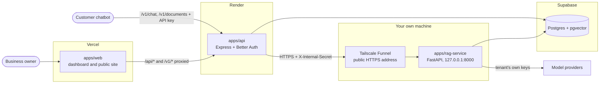
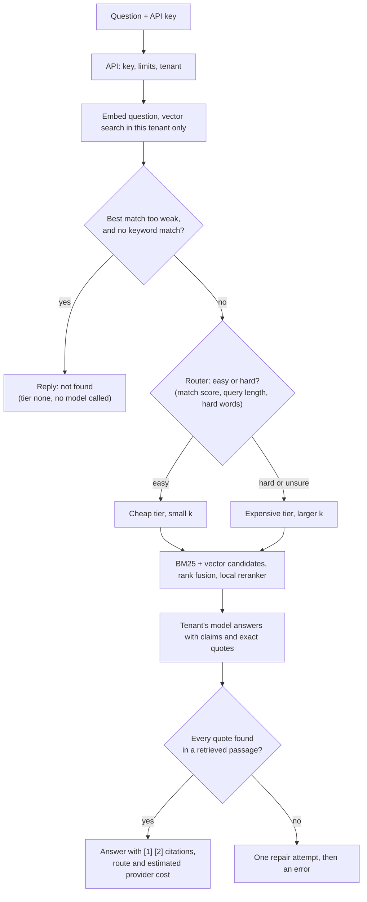

# Lumen

Lumen is a multi-tenant RAG gateway. A business signs in, uploads documents and gets an API key; its own chatbot then calls a single chat endpoint. Lumen answers only from that business's documents, picks a cheap or an expensive model per question, quotes the passages it used, and says so when the documents do not contain the answer. Every project is an isolated tenant, and the dashboard shows usage, routing and the tenant's estimated provider cost.

## Contents

- [How it works](#how-it-works)
- [Key features](#key-features)
- [Repository layout](#repository-layout)
- [Quick start](#quick-start)
- [Commands](#commands)
- [Tests](#tests)
- [Deployment](#deployment)
- [Documentation](#documentation)
- [Status](#status)
- [License](#license)

## How it works



The browser and the customer's chatbot talk only to the API. The API handles identity, API keys, limits and logging, then calls the RAG service, which is internal and never public: every `/internal/*` call needs the `X-Internal-Secret` header.

**Upload path.** The API checks the file type, size and the tenant's document limit, stores a document row as `processing` and answers at once. The RAG service extracts the text, splits it into chunks, embeds them (`all-MiniLM-L6-v2`, 384 dimensions) and stores them in pgvector with the `tenant_id`. The API then marks the document `ready` (or `failed`, with a readable reason).

**Chat path and router.** For each question the service embeds it, checks how well the best chunk matches, and decides which tier answers.



Models inside a tier are tried top to bottom. The answer travels back with its route (tier, `k`, difficulty, whether it escalated, top score) and usage (tokens, latency, estimated provider cost).

## Key features

- **Tenant isolation.** Every query on tenant data filters by `tenant_id`, taken from the session or API key and never from the request body. Another tenant's id behaves like a missing id (`404`). An isolation suite with a negative control checks this (see [Tests](#tests)).
- **Hybrid retrieval.** Tenant-local BM25 and vector search, fused by rank, then reranked by a local cross-encoder.
- **Cost-aware routing.** Easy questions go to the tenant's cheap model, hard or uncertain ones to the expensive model; a question the documents cannot answer calls no model at all.
- **Honest answers.** The model must return exact evidence quotes; the service validates them against the retrieved passages and writes the citations itself.
- **Bring your own models.** Each tenant adds its own provider models and keys. Keys are encrypted at rest (AES-256-GCM), never returned after saving, and tenant-supplied endpoints are checked against private and metadata addresses.
- **Dashboard.** Documents, API keys, a Try it box, analytics, a request log with per-request detail, a Models page and usage meters for documents, requests per minute and requests per month.
- **Accounts and projects.** Email and password with verification, Google and GitHub sign-in without implicit account linking, several projects per user.
- **No pricing of its own.** Lumen has no prices. A tenant may enter the price per 1M tokens of its own models; the dashboard then shows an "estimated provider cost".

## Repository layout

```text
lumen/
  apps/
    api/              Express + Better Auth API (TypeScript), code grouped by feature in src/modules
    rag-service/      FastAPI RAG service (Python): api, core, ingest, retrieval, llm
    web/              React + Vite dashboard and public site, code grouped by feature in src/features
  tools/
    eval/             tenant isolation suite and router evaluation (Python, standard library only)
  infra/
    sql/              numbered SQL migrations, applied with pnpm db:migrate
    .env.example      database password and Supabase connection strings (copy to infra/.env)
  scripts/            repo-level Node helpers behind the root package.json scripts
  docs/               project documentation: brief, workflow, database, website and design, notes
  .github/workflows/  CI: typecheck, lint, tests, tenant isolation with its negative control, web build
  .claude/            AI coding-agent setup used to build this repo (agents, the lumen-phase skill)
  .agents/            AI coding-agent setup used to build this repo (vendored Supabase skills)
  .serena/            AI coding-agent setup used to build this repo (Serena project config and memories)
  .codex/             AI coding-agent setup used to build this repo (Codex hooks)
  AGENTS.md           instructions for AI coding agents (CLAUDE.md points to it)
  docker-compose.yml  local Postgres 16 + pgvector
  render.yaml         Render Blueprint for the API
  package.json, pnpm-workspace.yaml, turbo.json   workspace and task runner
  biome.json, tsconfig.base.json, .editorconfig, .nvmrc   shared tooling configuration
  skills-lock.json    lock file for the vendored agent skills in .agents/
```

Each app keeps its environment file next to it (`apps/api/.env`, `apps/rag-service/.env`, `apps/web/.env`, `infra/.env`); there is no repo-root `.env`.

| Path | Read more |
| --- | --- |
| `apps/api` | [apps/api/README.md](apps/api/README.md) |
| `apps/rag-service` | [apps/rag-service/README.md](apps/rag-service/README.md) |
| `apps/web` | [apps/web/README.md](apps/web/README.md) |
| `tools/eval` | [tools/eval/README.md](tools/eval/README.md) |
| `infra/sql` | [infra/sql/README.md](infra/sql/README.md) |
| `scripts` | [scripts/README.md](scripts/README.md) |

## Quick start

Local development needs Node.js 22 or newer, pnpm 12 or newer, Python 3.12 or newer, and Podman or Docker for the database.

```bash
pnpm bootstrap      # install JS dependencies, create the rag-service .venv, create each app's .env from .env.example
# fill in apps/api/.env, apps/rag-service/.env and infra/.env (never commit them)
pnpm env:check      # required variables set, DATABASE_URL and INTERNAL_SECRET agree across apps (values are never printed)
pnpm db:up          # local Postgres 16 + pgvector (Podman or Docker) on port 5433
pnpm db:migrate     # apply infra/sql migrations once each (tracked in schema_migrations)
pnpm dev            # api :3000, web :5173, rag-service :8000
```

Open <http://localhost:5173>. The dashboard calls the API at `VITE_API_URL` (default `http://localhost:3000` in development), and the API's `DASHBOARD_ORIGIN` must be the dashboard's origin for sign-in cookies and CORS. Each app loads only its own `.env` plus the real environment. Without a compose provider the db scripts use `podman run`; with Docker, `docker compose --env-file infra/.env up -d db` also works.

## Commands

All commands run from the repo root.

| Command | What it does |
| --- | --- |
| `pnpm bootstrap` | Install dependencies, create the rag-service `.venv` and download its model files, create the `.env` files |
| `pnpm dev`, `dev:api`, `dev:web`, `dev:rag` | Start every app, or one |
| `pnpm build` | Build the web app and download the pinned RAG model files for offline runtime |
| `pnpm test` | Run every app's tests, one app at a time (the apps share the `lumen_test` database) |
| `pnpm typecheck`, `lint`, `format` | TypeScript (tsc, Biome) and Python (ruff) checks and formatting |
| `pnpm check` | typecheck + lint + test |
| `pnpm db:up`, `db:down` | Start or stop the local database container |
| `pnpm db:psql` | Open `psql` in the local database container |
| `pnpm db:migrate`, `db:status` | Apply pending SQL migrations, or list applied and pending ones |
| `pnpm env:init`, `env:check` | Create or verify the per-app `.env` files |
| `pnpm rag:funnel` | Run the rag-service in production mode on `127.0.0.1` for a Tailscale Funnel (`-- --check` validates its env file only) |
| `pnpm eval:isolation` | Run the tenant isolation suite against a scratch database |
| `pnpm clean` | Remove build and tool caches |

Apps document their own scripts in `apps/*/README.md`. Python commands go through `python -m app.cli` (see [apps/rag-service/README.md](apps/rag-service/README.md)).

## Tests

Tests need a test database once: `pnpm db:psql`, then `CREATE DATABASE lumen_test;`.

```bash
pnpm test                                                        # api, rag-service and web, one app at a time
pnpm check                                                       # typecheck + lint + test
pnpm --filter @lumen/web test                                    # web only (no database needed)
pnpm --filter @lumen/api test                                    # api only (lumen_test database)
pnpm --filter @lumen/rag-service test                            # rag-service only (lumen_test database)
apps/rag-service/.venv/bin/python -m pytest tools/eval/tests -q  # evaluation tool tests (fake servers, no provider)
pnpm eval:isolation                                              # tenant isolation suite and its negative control
```

No test calls a real model provider. GitHub Actions runs typechecking, lint, app and evaluation tests, tenant isolation with its negative control, and the web build on every push and pull request.

## Deployment

The intended hosting is free-tier friendly and split across four places:

| Part | Host | Notes |
| --- | --- | --- |
| Web (`apps/web`) | Vercel | A static build; `apps/web/vercel.json` proxies `/api` and `/v1` to the API so the browser only ever talks to the Vercel origin and the sign-in cookie stays first-party. Build setting: `VITE_API_URL=/` |
| API (`apps/api`) | Render, free plan | Docker web service from the `render.yaml` Blueprint (API only, one instance). The free plan spins down after 15 minutes idle, so the first request afterwards takes about a minute |
| RAG service (`apps/rag-service`) | Your own machine behind a Tailscale Funnel | It needs about 1 GB of RAM, more than Render's free plan. Run `pnpm rag:funnel`; the Funnel publishes `127.0.0.1:8000` at a public HTTPS address that the API calls. The machine must stay on, and `INTERNAL_SECRET` is the only protection on that address, so keep it long, random and out of git |
| Database | Supabase (Postgres + pgvector) | Use the session pooler (port 5432), not the transaction pooler (6543). Apply the SQL in `infra/sql` once |

Variables an operator must set (names only; set them as the host's secrets, never in git):

- **API (Render):** `NODE_ENV` (`production`), `DATABASE_URL`, `BETTER_AUTH_SECRET`, `BETTER_AUTH_URL` and `DASHBOARD_ORIGIN` (both the Vercel origin), `INTERNAL_SECRET`, `RAG_SERVICE_URL` (the Funnel address), `MODEL_KEY_ENCRYPTION_SECRET`, `MAX_DOCUMENTS_PER_TENANT`, `RATE_LIMIT_PER_MINUTE`, `MAX_REQUESTS_PER_MONTH`, `MAX_PROJECTS_PER_USER`, `SMTP_URL` and `MAIL_FROM` (required in production), and `TRUST_PROXY` (the number of proxy hops in front of the API). Optional: `GOOGLE_CLIENT_ID`, `GOOGLE_CLIENT_SECRET`, `GITHUB_CLIENT_ID`, `GITHUB_CLIENT_SECRET`.
- **Web (Vercel):** `VITE_API_URL`.
- **RAG service (your machine, `apps/rag-service/.env.funnel`):** `DATABASE_URL` and `INTERNAL_SECRET` (the same value as the API's).

Run exactly one API instance: rate-limit counters, the create-project lock and background ingests are kept in memory. The deployment configuration was verified locally only; the hosted setup has not been run end to end. See [apps/api/README.md](apps/api/README.md), [apps/rag-service/README.md](apps/rag-service/README.md) and [apps/web/README.md](apps/web/README.md) for each service's variables.

## Documentation

Start at the [documentation index](docs/README.md).

| Document | What it covers |
| --- | --- |
| [docs/AI_BUILD_BRIEF.md](docs/AI_BUILD_BRIEF.md) | The authoritative product brief: hard rules, stack, contracts, router rules, phases |
| [docs/PROJECT_WORKFLOW.md](docs/PROJECT_WORKFLOW.md) | System overview, journeys, auth, analytics, tech stack, security checklist |
| [docs/DATABASE.md](docs/DATABASE.md) | Database design and the reasons behind it |
| [docs/WEBSITE.md](docs/WEBSITE.md) | What each page and tab does, and the design system |
| [docs/lumen-website-ui-mockups/README.md](docs/lumen-website-ui-mockups/README.md) | The exported UI mockups |
| [docs/NOTES.md](docs/NOTES.md) | Dated project log |
| [AGENTS.md](AGENTS.md) | Instructions for AI coding agents |

## Status

Phases 0 to 5 are built: scaffold, RAG core, the Python service, the Express API with Better Auth, tenant models, the dashboard, accounts and projects, a normalized schema, and the isolation suite and evaluation harness. The evaluation results are preliminary: the reference answers were drafted by an agent from the source PDFs and are not yet verified by a human. A trained router classifier (Phase 6) is planned only if the rule-based router proves insufficient, and Lumen's own pricing (Phase 7) is on hold. The project is under active development.

## License

All rights reserved. No license is granted.
