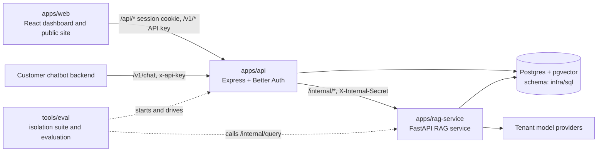

# Lumen documentation

> **Purpose:** the index of everything under `docs/`, grouped by what you are trying to do, plus a map of the codebase.
>
> **Audience:** contributors, reviewers and AI coding agents.
>
> **Status:** current. Where two documents disagree, `AI_BUILD_BRIEF.md` wins.

## Contents

- [Product and requirements](#product-and-requirements)
- [Architecture and data](#architecture-and-data)
- [Website and design](#website-and-design)
- [Build process with AI agents](#build-process-with-ai-agents)
- [Project log](#project-log)
- [Codebase map](#codebase-map)
- [Where the other Markdown files are](#where-the-other-markdown-files-are)

## Product and requirements

| Document | What it covers |
| --- | --- |
| [AI_BUILD_BRIEF.md](AI_BUILD_BRIEF.md) | The authoritative product brief: mission, hard rules, stack and environment variables, Better Auth setup, database schema, API contracts, router rules and the phase prompts with acceptance checks |

## Architecture and data

| Document | What it covers |
| --- | --- |
| [PROJECT_WORKFLOW.md](PROJECT_WORKFLOW.md) | System overview, upload and chat journeys, onboarding, auth and sessions, analytics, tech stack, model and hosting choices, setup stage, build phases, security checklist |
| [DATABASE.md](DATABASE.md) | Tenancy, tables, design decisions, environments and the state of the Supabase project. The authoritative schema is the SQL in `infra/sql/` |

## Website and design

| Document | What it covers |
| --- | --- |
| [WEBSITE.md](WEBSITE.md) | Part 1: what each public page and dashboard tab does. Part 2: the design system (color tokens, type, layout, components, motion, copy) |
| [lumen-website-ui-mockups/README.md](lumen-website-ui-mockups/README.md) | The exported HTML mockups the website was built from |

## Build process with AI agents

| Document | What it covers |
| --- | --- |
| [../AGENTS.md](../AGENTS.md) | Project instructions every coding agent reads first: reading order, the money rule, the agent team, the coding workflow, tools |
| `../.claude/agents/` | One file per project agent: `rag-engineer`, `api-engineer`, `web-engineer`, `eval-engineer` and the read-only `lumen-reviewer` |
| `../.claude/skills/lumen-phase/SKILL.md` | The `lumen-phase` skill that runs one build phase end to end |
| `../.serena/memories/` | Short project memories for the Serena code-navigation tool |

## Project log

| Document | What it covers |
| --- | --- |
| [NOTES.md](NOTES.md) | A dated log of decisions, phase results, reviews and ideas noted but not planned |

## Codebase map

Lumen is a pnpm workspace (`apps/*`) driven by Turborepo. Three apps make up the product, and `tools/eval` proves it works.

The request path is **web -> api -> rag-service -> Postgres**:

1. The browser talks only to `apps/api`. It signs in through Better Auth (`/api/auth/*`) and then calls `/api/dashboard/*` with a session cookie. A customer's chatbot calls `/v1/chat` and `/v1/documents` with an API key.
2. `apps/api` owns identity, tenants, keys, limits, model keys (encrypted) and request logging. For uploads and questions it calls `apps/rag-service` on `/internal/*` with the `X-Internal-Secret` header. The rag-service is never exposed to the public internet by design.
3. `apps/rag-service` owns chunking, embeddings, BM25 and vector retrieval, reranking, the cheap/expensive router, quote-validated answers and the model calls. It reads and writes chunks in Postgres.
4. Postgres (pgvector) holds the platform tables and the vectors. Every row carries a `tenant_id`, and every query filters on it.

| Path | Role | Details |
| --- | --- | --- |
| `apps/web` | Dashboard and public site (React, Vite) | [apps/web/README.md](../apps/web/README.md) |
| `apps/api` | Public API (Express, TypeScript, Better Auth) | [apps/api/README.md](../apps/api/README.md) |
| `apps/rag-service` | Internal RAG service (FastAPI, Python) | [apps/rag-service/README.md](../apps/rag-service/README.md) |
| `tools/eval` | Tenant isolation suite and router evaluation; not part of the product runtime | [tools/eval/README.md](../tools/eval/README.md) |
| `infra/sql` | Numbered SQL migrations | [infra/sql/README.md](../infra/sql/README.md) |
| `scripts` | Repo-level helpers for the root `package.json` scripts | [scripts/README.md](../scripts/README.md) |

`tools/eval` uses the same code as production: the isolation suite starts its own API and rag-service against a scratch database with a stub model, and the evaluation script calls the rag-service's `/internal/query` directly.

## Where the other Markdown files are

- [../README.md](../README.md): the project landing page.
- [../apps/api/README.md](../apps/api/README.md), [../apps/rag-service/README.md](../apps/rag-service/README.md), [../apps/web/README.md](../apps/web/README.md), [../tools/eval/README.md](../tools/eval/README.md): per-package guides.
- [../apps/rag-service/samples/harbor_cafe_handbook.md](../apps/rag-service/samples/harbor_cafe_handbook.md): a sample document used for local ingest checks.
