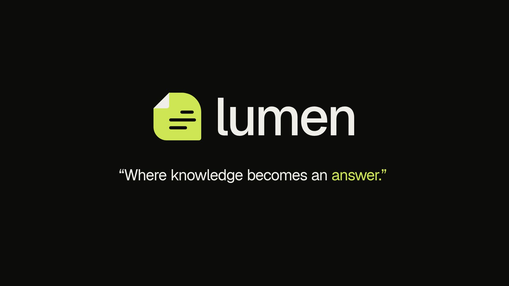

# Lumen — one-minute product promo

[Landscape MP4](exports/lumen-promo.mp4) · [Instagram / Reels MP4](exports/lumen-promo-instagram.mp4) · [Portrait cover](exports/lumen-promo-instagram-cover.jpg)



An editable Remotion promo based on `Aicyraa/lumen` main at
`2e451e70edb6aa6e550aa8e1c70302be727999c2`. Work lives on
`promo/lumen-rag-video`; the application and its dependency files are unchanged.

**60 seconds · 1920 × 1080 · 30 fps · 1,800 frames.**
Lumen’s actual logo, self-hosted Geist fonts, near-black/off-white palette and
lime accent. Perspective document stacks, a continuous RAG camera journey, moving data
packets, full-canvas kinetic typography, and open radial routing paths create
depth and continuous motion. Five matched camera glides and dissolves connect six scenes.
No navbar, chapter bar, footer, progress rule or dashboard-style information cards.
The closing signature slides the icon in from the right, builds “lumen” letter by
letter, reveals “Where knowledge becomes an answer.”, then slides the group left.
These are deterministic CSS 3D planes, not externally rendered stock footage.
A new original stereo soundtrack uses warm keys, soft bass and a brushed beat at 90 BPM.
It replaces the earlier bright electronic track and transition sweeps.
Text-led; no voiceover or external provider credentials required.

## Preview

This is a standalone project under `tools/`, outside the application workspace.
Node 24 is recommended. Use the existing checkout; no separate Git worktree is needed.

```sh
cd /workspace/lumen/tools/lumen-promo
npm ci --workspaces=false
npm run dev -- --no-open
```

Open `http://localhost:3100/LumenPromo`. Press Space to play/pause. The six scene
compositions are also individually editable in the **Scenes** folder.
`npm run dev` generates or refreshes the versioned score. The generated WAV is ignored;
its deterministic source is `scripts/score.mjs`.

## Storyboard

| Time      | Scene                     | Message                                                                                          |
| --------- | ------------------------- | ------------------------------------------------------------------------------------------------ |
| 00–08     | The missing piece         | Your chatbot needs your context. Give it Lumen.                                                  |
| 07.4–17.4 | Seamless RAG integration  | Upload → connect a project API key → ask through `POST /v1/chat`; freestanding kinetic words.    |
| 16.8–27.8 | Continuous RAG journey    | A continuous camera move carries documents through chunking, embedding, retrieval and reranking. |
| 27.2–41.2 | Model routing             | Packets follow cheap, expensive and no-match paths as the question changes.                      |
| 40.6–52.6 | An answer you can inspect | Open typographic evidence map: sources, route, tokens, latency and use cases.                    |
| 52–60     | Build with Lumen          | Icon slides in from the right → name builds → original quote → group slides out.                 |

Scenes overlap by 18 frames each: 1,890 authored frames minus 90 transition
frames equals exactly 1,800 frames / 60 seconds. Each scene remains independently
editable in Studio.

Copy follows the main-branch README, RAG service README and the current build
brief’s API and routing contracts. The router is rule-based; no learned routing,
accuracy benchmarks, savings, production-readiness or pricing claims are made.
Example questions are illustrative, not recorded provider responses.
Models are ordered primary/backups **inside** each of the two tiers; the video
does not promise cross-tier failover when an entire tier fails.

## Check or export

```sh
npm run typecheck
npm run lint
npm run build

# Re-export the MP4.
npm run render -- --browser-executable=/usr/bin/chromium

# Optional full-resolution still.
npm run still -- out/poster.png --frame=100 --browser-executable=/usr/bin/chromium
```

The browser flag uses the Chromium installed in this cloud environment. Omit it
on another machine to use Remotion’s browser, or supply a local Chromium path.
Fresh renders go into the ignored `out/` directory. The downloadable release
is checked in at `exports/lumen-promo.mp4` on the promo branch. No Lumen API, RAG server, database,
Hugging Face download, or running production service is needed to preview this video.

Verification: TypeScript, Remotion ESLint and bundle succeeded. Remotion loaded
the compositions with system Chromium; representative full-resolution stills
were inspected for all six scenes. Studio loaded the main composition and
reported 01:00.00 with no browser exceptions. The generated score is exactly
60 seconds. The MP4 is exported with H.264 video and AAC audio; the full exported
file decodes successfully with FFmpeg. Exported integration and transition frames
were checked after rendering.

Focus changes use continuous interpolation: rolling text, color blending, scale and camera movement. Router questions stay mounted and roll through a clipped window; model paths and labels blend together instead of toggling. The logo/name/quote outro is retained.

## Instagram / Reels version

The separate `LumenPromoMobile` composition is 1080 × 1920 (9:16), 30 fps and
60 seconds. It uses the same six scenes, exact words, timeline, transitions,
90 BPM stereo music and logo/quote ending. Scene layouts reflow for portrait:
integration steps stack, the routing diagram is rearranged, the RAG camera
uses a narrower track, and text wraps at phone-friendly sizes. It is not a crop
or letterboxed copy. Key copy stays roughly within x=90–990 and y=180–1600 to
leave room for common Reels overlays; actual Instagram controls vary by device.

Preview: `http://localhost:3100/LumenPromoMobile`. Export:

```sh
npm run render:mobile -- --browser-executable=/usr/bin/chromium --concurrency=2 --crf=18
```

The downloadable portrait release is `exports/lumen-promo-instagram.mp4`.
The landscape release is retained. A representative landscape frame was rendered
before and after the responsive changes and its PNG checksum matched exactly.

The portrait release uses H.264 / yuv420p / BT.709, stereo AAC at 48 kHz,
30 fps and fast-start MP4 packaging. The one-minute file was fully decoded for
validation, and stills from all six scenes were checked for portrait layout.
Studio preview playback was verified without browser exceptions.
